<div align="center">

# ⚡ ElectroSVG

### Publication-Grade IEEE / IEC Electrical Engineering Vector Symbol Library, Converter Topologies, Machine Windings, Lab Instruments & Scope SVG Studio

[](#complete-142-asset-catalog-with-visual-previews)
[](#unified-design-system--ieeeiec-style-guide)
[-dc2626?style=for-the-badge)](#2-drag-and-drop-in-drawio--diagramsnet-visio-replacement)
[](LICENSE)

<p align="center">
  <strong>Stop fighting Microsoft Visio for your IEEE Transactions & IEC journal papers.</strong><br/>
  <strong>ElectroSVG</strong> provides <strong>142 mathematically aligned, publication-ready SVG symbols, converter topologies, electrical machine cross-sections, stator windings, bench measurement instruments, and oscilloscope figures</strong>—all crafted in a single, strictly unified visual language.
</p>

<p align="center">
  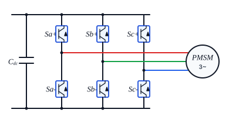
  &nbsp;&nbsp;
  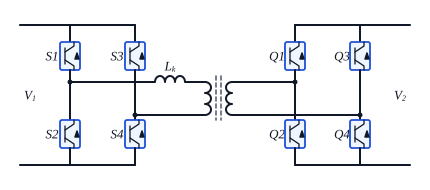
  &nbsp;&nbsp;
  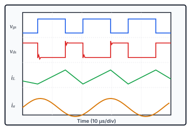
</p>

<p align="center">
  
  &nbsp;
  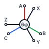
  &nbsp;
  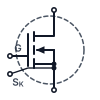
  &nbsp;
  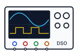
  &nbsp;
  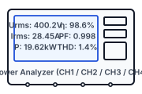
  &nbsp;
  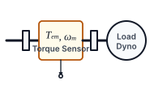
</p>

</div>

---

## ✨ Why ElectroSVG?

When preparing figures for **IEEE Transactions on Power Electronics (TPEL)**, **IEEE Transactions on Industrial Electronics (TIE)**, **IEEE Transactions on Energy Conversion (TEC)**, or **IET / Elsevier** journals, authors typically struggle with:
1. **Inconsistent stroke weights and fonts** when mixing Visio stencils, Simulink screenshots, and MATLAB plots.
2. **Missing modern components** such as 4-pin Kelvin-source SiC MOSFETs, GaN HEMTs, Hairpin stator slots, Dual 3-Phase ($30^\circ$) windings, IPMSM V-shape rotors, or bench hardware-in-the-loop (HIL) / Power Analyzer testbench icons.
3. **Rasterized / blurry oscilloscope screenshots** instead of crisp vector waveforms.

**ElectroSVG solves all three:**
- **142 Pure Vector SVGs** across **10 curated categories** (`symbols/01_passives` through `symbols/10_measurement_instruments`).
- **Interactive Web Studio (`index.html`)** with instant search, live stroke-width adjustment, 1-click SVG clipboard copy, and a **Parametric Multi-Channel Scope & PWM Waveform Synthesizer**.
- **Native Draw.io / diagrams.net Library (`electro_svg_library.drawio.xml`)** for zero-cost, drag-and-drop schematic drawing with orthogonal wire routing.
- **Zero-Error Validated XML**: Every SVG is verified by `verify_library.py` for strict XML well-formedness, unique scoped marker IDs, and $10\text{ px}$ terminal grid alignment.

---

## 🚀 Three Ways to Use

### 1. Interactive Web Studio & Scope SVG Generator (`index.html`)
Open `index.html` in any browser:
- **Tab 1 — Symbol & Circuit Explorer**: Filter by category or keyword, switch global stroke weights (`1.5 px`, `2.0 px`, `2.5 px`), and click **Copy SVG** to paste directly into **Figma, Inkscape, Adobe Illustrator, or PowerPoint**.
- **Tab 2 — Parametric Scope & Waveform Synthesizer**: Generate publication-ready multi-channel oscilloscope figures (3-phase SPWM + currents, Synchronous Buck steady-state, DAB Single-Phase-Shift waveforms, PMSM FOC step response) with real-time sliders for carrier frequency ratio, modulation index, and ripple.

### 2. Drag-and-Drop in Draw.io / diagrams.net (Visio Replacement)
1. Open [app.diagrams.net](https://app.diagrams.net/) or the **VS Code Draw.io Extension**.
2. Click **File → Open Library from → Device...** and select **`electro_svg_library.drawio.xml`**.
3. All **142 symbols** appear in your sidebar stencil palette! Drag them onto the canvas, snap wires to the $10\text{ px}$ pins, and export directly to cropped PDF or SVG for LaTeX (`\includegraphics` / `\includesvg`).

### 3. Direct SVG Files (`symbols/`) & Master Sprite (`master_sprite.svg`)
Use individual files in `symbols/<category>/<slug>.svg` or reference any symbol from `master_sprite.svg` via `<use href="master_sprite.svg#igbt_with_diode"/>`.

---

## 🎨 Unified Design System & IEEE/IEC Style Guide

| Parameter | Specification | CSS Class |
| :--- | :--- | :--- |
| **Canvas & Pin Grid** | `100 × 100` (standard symbols), terminals snapped to multiples of `10 px` | `.ee-pin` (`r = 2.2 px`, white fill) |
| **Primary Component Stroke** | `2.0 px` solid `#111827`, round caps & joins | `.ee-stroke` |
| **Secondary / Annotation Stroke** | `1.3 px` solid `#111827` (arrows, reference frames, ticks) | `.ee-thin` |
| **Busbar / Shaft / Plate Stroke** | `3.0 px` solid `#111827` (DC busbars, mechanical shafts) | `.ee-thick` |
| **Three-Phase / Semantic Colors** | Phase A / N-Pole: `#dc2626` · Phase B: `#16a34a` · Phase C / S-Pole: `#2563eb` | `.ee-wire-a`, `.ee-wire-b`, `.ee-wire-c` |
| **Typography** | `Times New Roman` *italic* for math variables ($v_{ds}, i_q, \theta_e$); `Inter` bold for labels | `.ee-text`, `.ee-label` |

---

## 📂 Complete 142-Asset Catalog with Visual Previews

### 01. Passives & Magnetics (`symbols/01_passives/` — 19 Assets)
| Preview | Name & File | Preview | Name & File | Preview | Name & File |
| :---: | :--- | :---: | :--- | :---: | :--- |
| 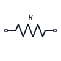 | **Resistor (IEEE)**<br/>`resistor_ieee.svg` | 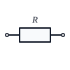 | **Resistor (IEC)**<br/>`resistor_iec.svg` | 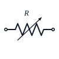 | **Variable Resistor**<br/>`resistor_variable.svg` |
| 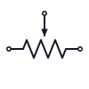 | **Potentiometer**<br/>`potentiometer.svg` | 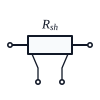 | **4-Wire Kelvin Shunt**<br/>`resistor_shunt_kelvin.svg` | 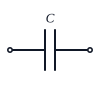 | **Capacitor**<br/>`capacitor_unpolarized.svg` |
| 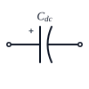 | **Polarized Cap (IEEE)**<br/>`capacitor_polarized_ieee.svg` | 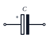 | **Polarized Cap (IEC)**<br/>`capacitor_polarized_iec.svg` | 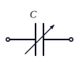 | **Variable Capacitor**<br/>`capacitor_variable.svg` |
| 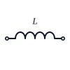 | **Inductor (Air Core)**<br/>`inductor_air.svg` | 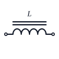 | **Inductor (Iron Core)**<br/>`inductor_iron_core.svg` | 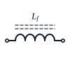 | **Inductor (Ferrite)**<br/>`inductor_ferrite_core.svg` |
| 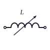 | **Variable Inductor**<br/>`inductor_variable.svg` | 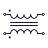 | **Common-Mode Choke**<br/>`coupled_inductor_cmc.svg` |  | **Ferrite Bead**<br/>`ferrite_bead.svg` |
| 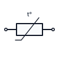 | **Thermistor (NTC/PTC)**<br/>`thermistor_ntc.svg` | 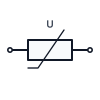 | **MOV Varistor**<br/>`varistor_mov.svg` | 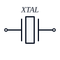 | **Crystal Resonator**<br/>`crystal_resonator.svg` |
|  | **Memristor**<br/>`memristor.svg` | | | | |

### 02. Sources & Grounds (`symbols/02_sources_grounds/` — 11 Assets)
| Preview | Name & File | Preview | Name & File | Preview | Name & File |
| :---: | :--- | :---: | :--- | :---: | :--- |
| 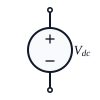 | **DC Voltage Source**<br/>`source_dc_voltage.svg` | 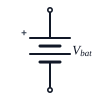 | **Battery Cell / Pack**<br/>`source_battery.svg` | 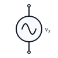 | **AC Voltage Source**<br/>`source_ac_voltage.svg` |
| 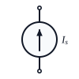 | **Current Source**<br/>`source_current.svg` | 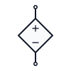 | **Controlled V-Source**<br/>`source_controlled_voltage.svg` | 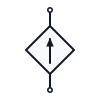 | **Controlled I-Source**<br/>`source_controlled_current.svg` |
| 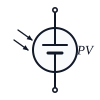 | **PV Solar Array**<br/>`source_pv_array.svg` | 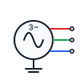 | **3-Phase AC Grid**<br/>`source_3ph_grid.svg` | 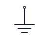 | **Earth Ground**<br/>`ground_earth.svg` |
| 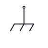 | **Chassis Ground**<br/>`ground_chassis.svg` | 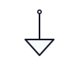 | **Signal Ground**<br/>`ground_signal.svg` | | |

### 03. Power Electronics Devices & Semiconductors (`symbols/03_semiconductors/` — 22 Assets)
| Preview | Name & File | Preview | Name & File | Preview | Name & File |
| :---: | :--- | :---: | :--- | :---: | :--- |
| 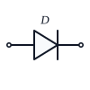 | **Power Diode**<br/>`diode_power.svg` | 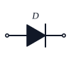 | **Power Diode (Filled)**<br/>`diode_filled.svg` | 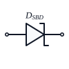 | **SiC Schottky Diode**<br/>`diode_schottky.svg` |
| 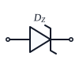 | **Zener Diode**<br/>`diode_zener.svg` |  | **Bidirectional TVS**<br/>`diode_tvs_bidir.svg` |  | **LED**<br/>`diode_led.svg` |
|  | **Photodiode**<br/>`diode_photo.svg` | 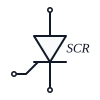 | **SCR Thyristor**<br/>`thyristor_scr.svg` | 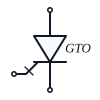 | **GTO / IGCT**<br/>`thyristor_gto_igct.svg` |
| 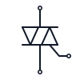 | **TRIAC**<br/>`triac.svg` | 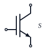 | **IGBT (Bare)**<br/>`igbt_bare.svg` | 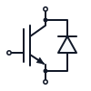 | **IGBT + Freewheeling Diode**<br/>`igbt_with_diode.svg` |
| 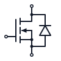 | **N-Ch Power MOSFET**<br/>`mosfet_nch_power.svg` | 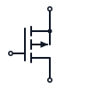 | **P-Ch Power MOSFET**<br/>`mosfet_pch_power.svg` |  | **SiC MOSFET (4-Pin Kelvin)**<br/>`sic_mosfet_kelvin.svg` |
| 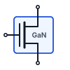 | **GaN HEMT**<br/>`gan_hemt.svg` | 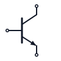 | **BJT NPN**<br/>`bjt_npn.svg` | 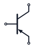 | **BJT PNP**<br/>`bjt_pnp.svg` |
|  | **Ideal Gate Switch**<br/>`ideal_power_switch.svg` |  | **4-Quadrant Switch**<br/>`bidirectional_switch_4q.svg` |  | **2-in-1 Half-Bridge Module**<br/>`half_bridge_leg_module.svg` |
|  | **Isolated Gate Driver**<br/>`optocoupler_isolated_driver.svg` | | | | |

### 04. Transformers & Machine Windings (`symbols/04_transformers_windings/` — 17 Assets)
| Preview | Name & File | Preview | Name & File | Preview | Name & File |
| :---: | :--- | :---: | :--- | :---: | :--- |
|  | **1-Ph 2-Winding TX**<br/>`transformer_1ph_2w.svg` |  | **HF Center-Tapped TX**<br/>`transformer_hf_center_tapped.svg` |  | **2-Winding TX (IEC)**<br/>`transformer_2winding_iec.svg` |
|  | **3-Winding TX (IEC)**<br/>`transformer_3winding_iec.svg` |  | **Autotransformer**<br/>`autotransformer.svg` |  | **Current Transformer (CT)**<br/>`current_transformer_ct.svg` |
|  | **Planar PCB Transformer**<br/>`transformer_planar_pcb.svg` |  | **3-Ph Wye ($Y$) Winding**<br/>`winding_3ph_wye.svg` |  | **Grounded Wye ($Y_n$)**<br/>`winding_3ph_wye_grounded.svg` |
|  | **3-Ph Delta ($\Delta$) Winding**<br/>`winding_3ph_delta.svg` |  | **Open-End Winding (OEW)**<br/>`winding_3ph_open_end.svg` |  | **Dual 3-Ph ($30^\circ$ 6-Ph)**<br/>`winding_dual_3ph_6ph.svg` |
|  | **5-Ph Star Winding**<br/>`winding_5ph_star.svg` |  | **Zig-Zag Winding**<br/>`winding_zigzag.svg` |  | **Hairpin Stator Slot**<br/>`stator_slot_hairpin.svg` |
|  | **FSCW Tooth-Coil Winding**<br/>`winding_concentrated_tooth.svg` |  | **Star of Slots Phasors**<br/>`winding_star_of_slots.svg` | | |

### 05. Electrical Machines & Rotor Cross-Sections (`symbols/05_electrical_machines/` — 13 Assets)
| Preview | Name & File | Preview | Name & File | Preview | Name & File |
| :---: | :--- | :---: | :--- | :---: | :--- |
|  | **DC Machine (Brushed)**<br/>`machine_dc_brushed.svg` |  | **Separately Excited DC**<br/>`machine_dc_sep_excited.svg` |  | **3-Ph Induction Motor (IM)**<br/>`machine_3ph_induction_scim.svg` |
|  | **Doubly-Fed IG (DFIG)**<br/>`machine_3ph_dfig.svg` |  | **PMSM / BLDC Motor**<br/>`machine_3ph_pmsm.svg` |  | **SPMSM Rotor Cross-Section**<br/>`rotor_cross_section_spmsm.svg` |
|  | **IPMSM V-Shape Rotor**<br/>`rotor_cross_section_ipmsm.svg` |  | **SynRM Flux-Barrier Rotor**<br/>`rotor_cross_section_synrm.svg` |  | **6/4 Switched Reluctance**<br/>`machine_srm_salient.svg` |
|  | **Sync Generator (WFSG)**<br/>`machine_3ph_sync_generator.svg` |  | **Axial-Flux PM (AFPM)**<br/>`machine_axial_flux_afpm.svg` |  | **Linear PMSM (LPMSM)**<br/>`machine_linear_motor_lsm.svg` |
|  | **Rotary Encoder / Resolver**<br/>`sensor_encoder_resolver.svg` | | | | |

### 06. Control Blocks & Coordinate Transforms (`symbols/06_control_blocks/` — 12 Assets)
| Preview | Name & File | Preview | Name & File | Preview | Name & File |
| :---: | :--- | :---: | :--- | :---: | :--- |
|  | **Summing Junction**<br/>`control_summing_junction.svg` |  | **PI / PID Controller**<br/>`control_pi_regulator.svg` |  | **PR Resonant Controller**<br/>`control_pr_regulator.svg` |
|  | **Integrator ($\int dt$)**<br/>`control_integrator.svg` |  | **Clarke ($abc \to \alpha\beta$)**<br/>`transform_clarke_abc_ab.svg` |  | **Park ($\alpha\beta \to dq$)**<br/>`transform_park_ab_dq.svg` |
|  | **Inverse Park ($dq \to \alpha\beta$)**<br/>`transform_inv_park_dq_ab.svg` |  | **Direct Park ($abc \to dq$)**<br/>`transform_abc_to_dq.svg` |  | **SVPWM Modulator**<br/>`control_svpwm_block.svg` |
|  | **SRF-PLL Block**<br/>`control_pll_block.svg` |  | **Saturation Limiter**<br/>`control_limiter_saturation.svg` |  | **Hysteresis Comparator**<br/>`control_hysteresis.svg` |

### 07. Sensors, Switchgear & Protection (`symbols/07_sensors_protection/` — 8 Assets)
| Preview | Name & File | Preview | Name & File | Preview | Name & File |
| :---: | :--- | :---: | :--- | :---: | :--- |
|  | **Operational Amplifier**<br/>`opamp.svg` |  | **Hall Current Sensor (LEM)**<br/>`sensor_hall_current.svg` |  | **Voltmeter (V)**<br/>`meter_voltmeter.svg` |
|  | **Ammeter (A)**<br/>`meter_ammeter.svg` |  | **Circuit Breaker (CB)**<br/>`breaker_cb.svg` |  | **Fuse (IEC)**<br/>`fuse_iec.svg` |
|  | **Contactor / Relay**<br/>`contactor_relay.svg` |  | **SLD 3-Wire Busbar**<br/>`sld_3wire_bus.svg` | | |

### 08. Complete Power Electronics Topologies (`symbols/08_power_topologies/` — 15 Assets)
| Preview | Name & File | Preview | Name & File |
| :---: | :--- | :---: | :--- |
|  | **Synchronous Buck Converter**<br/>`topology_sync_buck.svg` |  | **Boost DC-DC Converter**<br/>`topology_boost.svg` |
|  | **1-Phase Full-Bridge (H-Bridge)**<br/>`topology_h_bridge_1ph.svg` |  | **3-Phase 2-Level VSI Motor Drive**<br/>`topology_3ph_2level_vsi.svg` |
|  | **3-Level NPC Phase Leg**<br/>`topology_3level_npc_leg.svg` |  | **3-Level T-Type Phase Leg**<br/>`topology_3level_ttype_leg.svg` |
|  | **3-Level Flying Capacitor Leg**<br/>`topology_3level_flying_cap.svg` |  | **Dual Active Bridge (DAB)**<br/>`topology_dab_converter.svg` |
|  | **LLC Resonant Tank Stage**<br/>`topology_llc_resonant_tank.svg` |  | **MMC Half-Bridge Submodule**<br/>`topology_mmc_submodule.svg` |
|  | **LCL Grid-Tie Filter**<br/>`topology_lcl_filter.svg` |  | **3-Ph 6-Pulse Diode Rectifier**<br/>`topology_3ph_diode_rectifier.svg` |
|  | **Vienna Rectifier Phase Leg**<br/>`topology_vienna_rectifier_leg.svg` |  | **Z-Source Impedance Network**<br/>`topology_z_source_network.svg` |
|  | **Complete PMSM Field-Oriented Control (FOC) Loop**<br/>`diagram_foc_complete_loop.svg` | | |

### 09. Scope & Waveform Publication Figures (`symbols/09_scope_waveforms/` — 7 Assets)
| Preview | Name & File | Preview | Name & File |
| :---: | :--- | :---: | :--- |
|  | **4-Channel Digital Oscilloscope Plot**<br/>`scope_4ch_power_electronics.svg` |  | **Carrier SPWM Modulation**<br/>`waveform_spwm_carrier.svg` |
|  | **SVPWM Space-Vector Hexagon**<br/>`diagram_svpwm_hexagon.svg` |  | **$abc / \alpha\beta / dq$ Phasor Diagram**<br/>`diagram_dq_phasor_frame.svg` |
|  | **ZVS Soft-Switching & Dead-Time**<br/>`waveform_zvs_commutation.svg` |  | **Control Loop Bode Plot**<br/>`waveform_bode_plot.svg` |
|  | **Harmonic FFT & THD Bar Chart**<br/>`waveform_fft_thd_spectrum.svg` | | |

### 10. Lab & Read Instruments (`symbols/10_measurement_instruments/` — 18 Assets)
| Preview | Name & File | Preview | Name & File | Preview | Name & File |
| :---: | :--- | :---: | :--- | :---: | :--- |
|  | **Wattmeter (W)**<br/>`meter_wattmeter.svg` |  | **VARmeter (var)**<br/>`meter_varmeter.svg` |  | **Power Factor ($\cos\varphi$)**<br/>`meter_power_factor.svg` |
|  | **Frequency Meter (Hz)**<br/>`meter_frequency_hz.svg` |  | **Smart Energy Meter (kWh)**<br/>`meter_energy_kwh.svg` |  | **Galvanometer (G)**<br/>`meter_galvanometer.svg` |
|  | **Ohmmeter ($\Omega$)**<br/>`meter_ohmmeter.svg` |  | **Analog Pointer Gauge**<br/>`instrument_analog_dial_gauge.svg` |  | **Potential Transformer (PT/VT)**<br/>`instrument_potential_transformer_vt.svg` |
|  | **Clamp / Rogowski Probe**<br/>`probe_current_clamp_rogowski.svg` |  | **HV Differential Probe**<br/>`probe_hv_differential.svg` |  | **Bench Oscilloscope (DSO)**<br/>`instrument_bench_oscilloscope.svg` |
|  | **Precision Power Analyzer**<br/>`instrument_power_analyzer.svg` |  | **6½-Digit Bench DMM**<br/>`instrument_digital_multimeter.svg` |  | **Impedance / EMI Analyzer**<br/>`instrument_spectrum_impedance_analyzer.svg` |
|  | **Prog. DC Supply / Load**<br/>`instrument_programmable_dc_supply_load.svg` |  | **DSP / FPGA / HIL Box**<br/>`instrument_dsp_fpga_hil_box.svg` |  | **Torque Sensor & Dyno**<br/>`instrument_torque_transducer_dyno.svg` |

---

## 🛠️ Rebuilding & Verifying from Source

The entire library is generated deterministically via Python 3 (zero external dependencies):

```bash
python generate_library.py          # Generates all 142 SVG files + catalog.json
python build_studio_and_exports.py  # Builds master_sprite.svg + electro_svg_library.drawio.xml
python build_html_studio.py         # Builds interactive index.html Studio
python verify_library.py            # Runs strict XML, path, class & ID collision verification
python cross_verify_with_jmag_suite.py  # Cross-verifies windings, dq-phasors, KVL/power balance & FFT/THD against jmag-agent-suite
```

### 🔬 Cross-Verification with `jmag-agent-suite` Physics & Winding Engine

All machine, winding, phasor, and harmonic figures are mathematically cross-verified against the analytical and physics-invariant engines in `jmag-agent-suite` (`jmag_bridge.winding`, `jmag_bridge.estimate`, `jmag_bridge.health`):

- **Star of Slots & FSCW Tooth-Coil Layout (`winding_star_of_slots.svg`, `winding_concentrated_tooth.svg`)**: Verified against `winding.plan(slots=12, poles=10, phases=3, layers=2)` ($q = 0.4$, coil pitch $y = 1$, fundamental winding factor $k_{w1} = 0.93301$, anti-periodic $180^\circ$ symmetry).
- **5-Phase Pentaphase Star Winding (`winding_5ph_star.svg`)**: Verified against `winding.plan(slots=10, poles=8, phases=5, layers=2)` ($q = 0.25$, $k_{w1} = 0.95106$).
- **$dq$-Axis Phasor & MTPA Reluctance Torque (`diagram_dq_phasor_frame.svg`, `rotor_cross_section_ipmsm.svg`)**: Verified against `estimate.torque_dq` ($T = \frac{3}{2} p [\psi_m i_q + (L_d - L_q) i_d i_q]$, with $i_d < 0$ in the 2nd quadrant of the $d$-$q$ frame for IPMSM MTPA and $K_t / K_e = 1.500000$).
- **Waveform Invariants & Harmonic THD (`scope_4ch_power_electronics.svg`, `waveform_fft_thd_spectrum.svg`)**: Verified against `health.kvl_residual` ($\max |R i + d\psi/dt - v| / V_{\max} = 1.44 \times 10^{-14} < 10^{-3}$), `health.power_balance` ($0.30\%$ difference $< 5\%$), and `health.harmonics` ($\text{THD} = 2.16\%$).

---

## 📄 License

Released under the **MIT License**. Free for academic papers, IEEE/IEC publications, textbooks, slides, and commercial engineering documentation.
